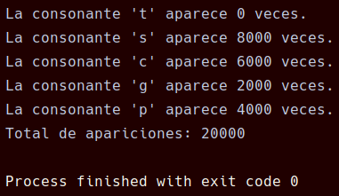

# Tarea 17 - Contador de caracteres

**Módulo:** Programación de servizos e procesos  
**Curso:** CFGS DAM 2 - 2026/2027  
**Alumno:** René Chamorro Crugeiras

## 1. Descripción

Programa en Java que solicita cinco consonantes y un texto por teclado. El texto se repite 2000 veces mediante `repeat(2000)`.

## 2. Funcionamiento

- Se crean cinco hilos, uno por cada consonante.
- Cada hilo cuenta las apariciones de su consonante en el texto.
- Todos los hilos comparten un contador total protegido mediante `synchronized`.
- Se utiliza `join()` para esperar a que terminen todos los hilos.
- Al finalizar, se muestran los resultados individuales y el total de apariciones.

## 3. Capturas de pantalla

### 3.1. Introducción de datos

Captura de la ejecución del programa donde se introducen las cinco consonantes y el texto.

### 3.2. Resultados

Captura donde se muestran las apariciones contadas por cada hilo y el total.

## 4. Conclusión

Con esta práctica se ha aprendido a crear y ejecutar varios hilos en Java, utilizar `Runnable` y `Thread`, y sincronizar el acceso a un contador compartido mediante `synchronized`. También se ha trabajado con `join()` para esperar a que finalicen todos los hilos antes de mostrar los resultados.

## 5. Declaración de uso de IA

Se ha utilizado ChatGPT como apoyo para resolver dudas sobre la programación en Java, comprender el funcionamiento de los hilos y corregir errores del código.

### Promts utilizados

- Estoy realizando una práctica de Java llamada Contador de caracteres para la asignatura de Programación de Servicios y Procesos de 2.º de DAM. El programa debe pedir por teclado cinco consonantes y un texto, repetir el texto 2000 veces con repeat(2000) y crear un hilo por cada consonante para contar cuántas veces aparece en el texto. Además, todos los hilos deben sumar sus apariciones a un contador total compartido. Explícame cómo organizar el código en una única clase, cómo sincronizar el contador compartido para evitar problemas de concurrencia y cómo utilizar `join()` para mostrar los resultados individuales y el total al finalizar todos los hilos, todo esto sin darme el código tal cual, unicamente explicación.