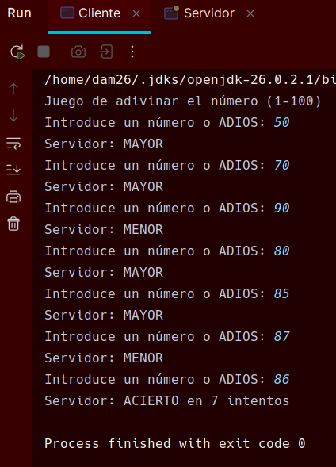
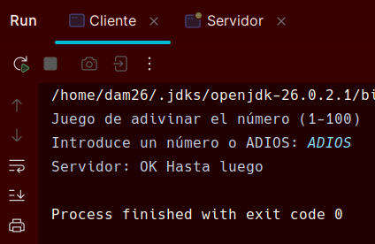

# Práctica TCP - Adivinar un número

## Funcionamiento

El servidor responde a los mensajes recibidos:

- Si el número es menor que el secreto, responde MAYOR.
- Si el número es mayor que el secreto, responde MENOR.
- Si el número es correcto, responde ACIERTO en N intentos.
- Si recibe ADIOS, responde OK Hasta luego y cierra la conexión.
- Si recibe cualquier otro comando, responde ERR Comando no válido.

## Partida de prueba con nc

Para realizar la prueba, primero arrancamos el servidor:

```bash
java Servidor
```

Después arrancamos el cliente:

```bash
java Cliente
```

Ejemplo de partida (suponiendo que el número secreto es 42):

```text
20
MAYOR
60
MENOR
hola
ERR Comando no válido
42
ACIERTO en 3 intentos
```

Ejemplo de partida (real)



También comprobamos el comando ADIOS en otra conexión:



## Desconexión del cliente

Si el cliente se cierra mediante Ctrl+C, el servidor detecta
la desconexión y continúa funcionando sin mostrar una traza
de excepción.

## Ejecución

1. Ejecutar primero Servidor.java.
2. Ejecutar Cliente.java.
3. Introducir números entre 1 y 100.
4. Seguir las indicaciones del servidor hasta acertar.
5. También se puede escribir ADIOS para salir.
