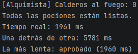
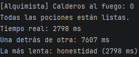
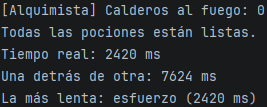

# Tarea 9b - El caldero de Don Magufo

**Módulo:** Programación de servizos e procesos  
**Curso:** CFGS DAM 2 - 2026/2027  
**Alumno:** René Chamorro Crugeiras

---

## 1. Descripción

Este proyecto consiste en simular la preparación de cuatro pociones mediante programación concurrente en Java.

Cada poción se prepara en un hilo independiente, lo que permite que las cuatro se elaboren simultáneamente. Durante la preparación, cada poción pasa por varias fases, cuya cantidad y duración se generan aleatoriamente.

Al finalizar, el programa muestra el tiempo real de ejecución, la suma de los tiempos individuales y la poción que más ha tardado en prepararse.

## 2. Estructura del proyecto

El proyecto está formado por las siguientes clases:

`Pocion.java` Define las características de cada poción y su proceso de preparación.   
`Alquimista.java` Contiene el método `main`, crea los hilos, coordina su ejecución y muestra el informe final.

## 3. Funcionamiento de la clase Pocion

La clase `Pocion` implementa la interfaz `Runnable`, por lo que puede ejecutarse dentro de un hilo sin necesidad de heredar de `Thread`.

Al crear una poción, se generan aleatoriamente los siguientes valores:

- Número de fases: entre 4 y 8, ambos incluidos.
- Duración de cada fase: entre 200 y 400 milisegundos, ambos incluidos.

El método `run()` recorre las fases de preparación. En cada fase, el hilo espera el tiempo correspondiente mediante `Thread.sleep()` y muestra el progreso por consola.

Al terminar, calcula y guarda el tiempo total empleado en preparar la poción.

### Captura 


*Captura del código de la clase `Pocion.java`.*

## 4. Funcionamiento de la clase Alquimista

La clase `Alquimista` contiene el método principal del programa.

Sus funciones son:

1. Crear las cuatro pociones: `aprobado`, `honestidad`, `esfuerzo` y `trabajo`.
2. Crear un hilo independiente para cada poción.
3. Mostrar cuántos calderos están al fuego antes de arrancar los hilos.
4. Arrancar todos los hilos mediante `start()`.
5. Volver a contar los hilos activos utilizando `isAlive()`.
6. Esperar a que terminen todos los hilos mediante `join()`.
7. Calcular el tiempo real, la suma de los tiempos individuales y la poción más lenta.

### Captura


*Captura del código de la clase `Alquimista.java`.*

## 5. Ejecución del programa

Al ejecutar el programa, las cuatro pociones comienzan a prepararse de forma concurrente.

Durante la ejecución, se muestra el avance de cada poción, indicando la fase actual y el número total de fases. Cuando una poción termina, se imprime el tiempo que ha tardado.

El orden de los mensajes puede variar entre ejecuciones debido a la planificación de los hilos.

### Captura


*Captura de la consola durante la preparación simultánea de las pociones.*

### Captura


*Captura de los mensajes que indican que las pociones han terminado y sus tiempos individuales.*

## 6. Informe final

Cuando todas las pociones han terminado, el programa muestra un informe con los siguientes datos:

- **Calderos al fuego:** número de hilos que siguen ejecutándose.
- **Tiempo real:** tiempo transcurrido desde el inicio de la medición hasta que terminan todas las pociones.
- **Una detrás de otra:** suma de los tiempos individuales de las cuatro pociones.
- **La más lenta:** nombre de la poción que ha tardado más y su tiempo de preparación.

### Captura


*Captura del informe completo al final de la ejecución.*

## 7. Pruebas de ejecución

Se realizarán tres ejecuciones del programa para comprobar el comportamiento de los hilos y comparar los tiempos de preparación.

| Ejecución | Poción más lenta (fases × ms) | Tiempo real (ms) | Suma (ms) |
|---:|---|---:|---:|
| 1 | aprobado (7 × 280) | 1961 | 5781 |
| 2 | honestidad (8 × 349) | 2798 | 7607 |
| 3 | esfuerzo (7 × 345) | 2420 | 7624 |


### Captura



*Captura de la primera ejecución completa.*

### Captura



*Captura de la segunda ejecución completa.*

### Captura



*Captura de la tercera ejecución completa.*

## 8. Ejemplo de salida

La salida tendrá una estructura similar a la siguiente. Los tiempos, las fases y el orden de los mensajes pueden cambiar en cada ejecución.

```text
[Alquimista] Calderos al fuego: 0
[Alquimista] Calderos al fuego: 4
[aprobado] fase 1/6
[honestidad] fase 1/8
[esfuerzo] fase 1/6
[trabajo] fase 1/5
...
[aprobado] lista en 1445 ms
[esfuerzo] lista en 1604 ms
[honestidad] fase 8/8
[honestidad] lista en 1897 ms
[trabajo] lista en 1250 ms
[Alquimista] Calderos al fuego: 0
Todas las pociones están listas.
Tiempo real: 1898 ms
Una detrás de otra: 6196 ms
La más lenta: honestidad (1897 ms)
```

## 9. Conclusión

Con esta práctica se han trabajado los conceptos básicos de programación concurrente en Java. Se ha utilizado `Runnable` para definir las tareas, `Thread` para ejecutarlas concurrentemente, `sleep()` para simular el tiempo de preparación y `join()` para coordinar la finalización de los hilos.

Además, se ha aprendido a consultar el estado de los hilos y a calcular estadísticas sobre el tiempo de ejecución, comprobando las diferencias entre el tiempo real transcurrido y la suma de los tiempos individuales.

## 10. Declaración de uso de inteligencia artificial

Se ha utilizado Inteligencia Artificial como herramienta de apoyo durante el desarrollo de la práctica, principalmente para resolver dudas, comprender el funcionamiento de los hilos y revisar la estructura del código.

### Prompts utilizados

- Ayúdame a entender el enunciado de la práctica del alquimista y las pociones. Explícame que se pide en cada apartado y que aspectos debo tener en cuenta para realizarla correctamente, sin darme el código ni resolver el ejercicio por mi.